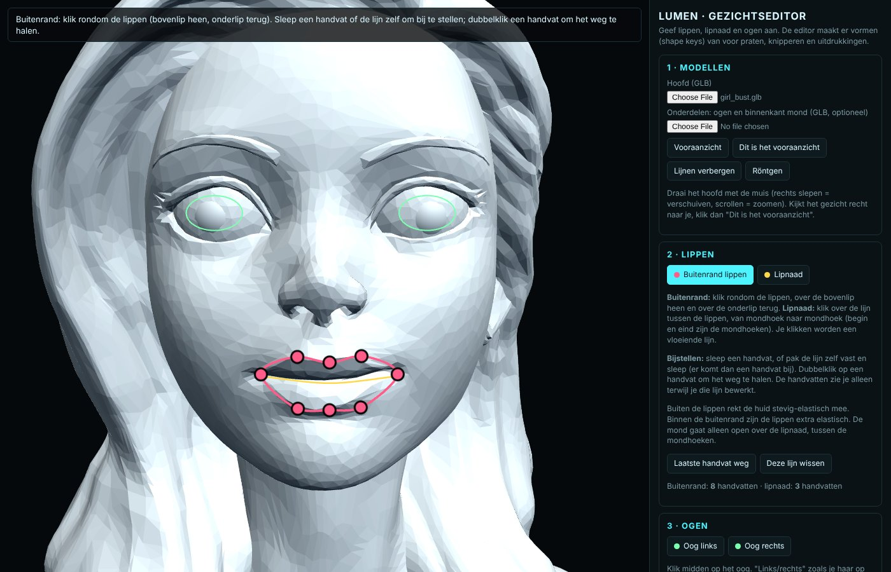
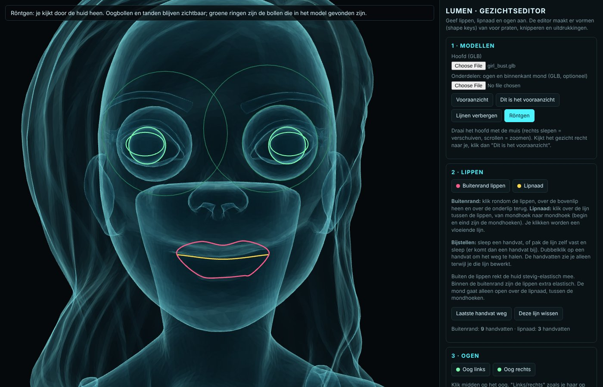
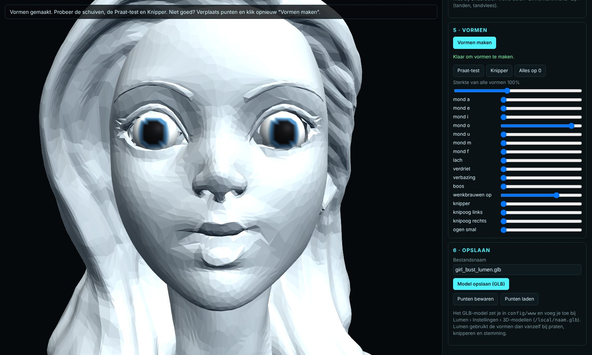

# Face Editor

**Give a 3D head expressive shape keys in your browser: mouth shapes for talking, blinking and moods.**
Made for [Lumen](https://github.com/Endless1977/Lumen), the holographic talking assistant for Home
Assistant, but the result is a normal `.glb` that works anywhere morph targets do (three.js, Blender,
game engines).

> 🇳🇱 De editor zelf is in het Nederlands. Zie [Nederlands](#nederlands) hieronder.

## Use it

Open **https://endless1977.github.io/Face-Editor/** or download [`index.html`](index.html) and open it
in Chrome or Edge. Everything happens in your browser: your models are not uploaded anywhere. The page
loads three.js from a CDN, so it needs an internet connection.

1. **Models**: load the head (`.glb`). Optionally load a second `.glb` with eyeballs and the inside
   of a mouth (teeth, gums) and choose per part what it is: left eye, right eye or mouth.
   Turn the head so it looks straight at you and click *Dit is het vooraanzicht* (this is the front).
2. **Lips**: click around the outline of the lips (over the upper lip and back under the lower lip),
   then along the line between the lips from corner to corner. Your clicks become a smooth line.
   Adjust it by dragging a handle or by grabbing the line itself (a new handle appears there);
   double-click a handle to remove it. Handles only show while you edit that line.
3. **Eyes**: click the middle of each eye. If the head model already has eyeballs, the eye snaps onto
   the ball; *Oogbollen in het model zoeken* finds and matches both at once. Per eye you keep the
   model's own eyeball or replace it with one from the parts file. Without eyeballs in the model, set
   the size, depth and eye opening yourself; the old eye can be cut out so the new eyeball fits.
   *Spiegel* copies one eye to the other side.
4. **Inside of the mouth**: size, depth and height of the teeth; the lower half follows the jaw.
5. **Make shapes** (*Vormen maken*): test every shape with a slider, with the talk test and blink.
   Not right? Move points and make them again. *Sterkte* scales all shapes.
6. **Save** (*Model opslaan*): a `.glb` with the shape keys, eyeballs and mouth interior.
   *Punten bewaren* saves your points so you can continue later.

**Röntgen** (x-ray) makes the skin see-through, so you can check how eyeballs and teeth sit inside
the head. Green rings are the eyeballs found in the model.

## Shape keys

| Group | Names |
|---|---|
| Talking | `mond_a`, `mond_e`, `mond_i`, `mond_o`, `mond_u`, `mond_m`, `mond_f` |
| Eyes | `knipper` (both), `knipoog_links`, `knipoog_rechts` (as seen on screen), `ogen_smal` |
| Moods | `lach`, `verdriet`, `verbazing`, `boos`, `wenkbrauwen_op` |

How the face moves:

- **Outside the lips** the skin is firm but elastic: it stretches smoothly and never tears.
- **Inside the lip outline** the lips are extra elastic and follow the mouth shapes more strongly.
- The mouth **opens only on the lip line**, between the two corners; towards the corners the
  opening closes, so the corners stay together.
- Eyelids slide **over** the eyeball when blinking, and the model's own eyeballs never deform.

The model is saved as a triangle soup with sparse morph targets, so the lips can really part along
the lip line. The names are in `mesh.extras.targetNames`, as glTF tools expect.

## Notes

- The shapes are computed from your points, not sculpted by hand. Small, careful points around the
  lips give the best result.
- Keep the licence of the models you use in mind before sharing the result. A model licensed
  CC BY needs credit to its author; a model without a licence may not be shared without permission.
- The screenshots use *"Girl bust"* by [mariuz_yaphets](https://sketchfab.com/3d-models/girl-bust-de07a03f8c4149c0b8cf326ca853a6b8)
  (CC BY 4.0) and the editor's built-in eyeballs.

## Licence

MIT, see [LICENSE](LICENSE). Uses [three.js](https://threejs.org) (MIT).

---

## Nederlands

**Geef een 3D-hoofd in je browser shape keys: mondvormen om te praten, knipperen en stemmingen.**
Gemaakt voor [Lumen](https://github.com/Endless1977/Lumen), maar het resultaat is een gewone `.glb`.

Open **https://endless1977.github.io/Face-Editor/** of download `index.html` en open die in Chrome of
Edge. Je modellen blijven op je eigen computer.

1. Laad het hoofd, en eventueel een GLB met oogbollen en tanden.
2. Klik rondom de lippen, daarna over de lipnaad van mondhoek naar mondhoek. Je klikken worden een
   vloeiende lijn: sleep een handvat of de lijn zelf om bij te stellen, dubbelklik een handvat om het
   weg te halen.
3. Klik midden op elk oog (het klikt vast op de oogbol als die in het model zit, of gebruik
   *Oogbollen in het model zoeken*) en stel de oogopening in. Kies per oog: bol uit het model houden
   of vervangen.
4. Stel de binnenkant van de mond in.
5. **Vormen maken**, testen met de schuiven, Praat-test en Knipper.
Buiten de lippen rekt de huid stevig-elastisch mee, binnen de buitenrand zijn de lippen extra
elastisch, en de mond gaat alleen open over de lipnaad. **Röntgen** laat je door de huid heen kijken.

6. **Model opslaan** geeft een `.glb`; zet die in `config/www` en voeg hem in Lumen toe bij
   Instellingen › 3D-modellen (`/local/naam.glb`).
